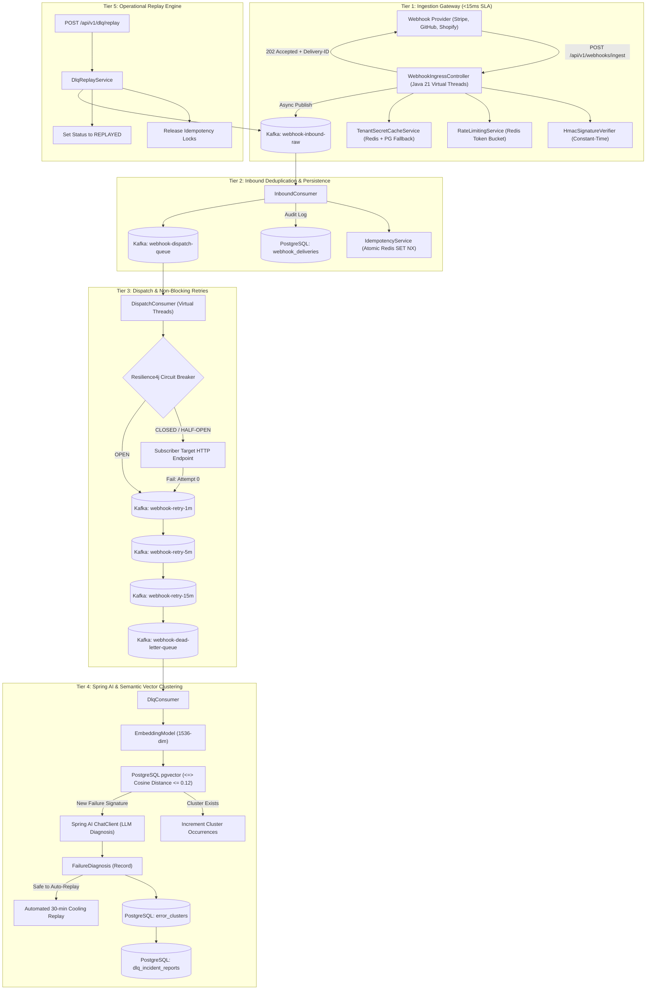

# HookShield: Enterprise Multi-Tenant Webhook Ingestion & AI DLQ Hub

[](https://openjdk.org/projects/jdk/21/)
[](https://spring.io/projects/spring-boot)
[](https://kafka.apache.org/)
[](https://github.com/pgvector/pgvector)
[](https://redis.io/)
[](https://spring.io/projects/spring-ai)

**HookShield** is a distributed, high-throughput, multi-tenant webhook ingestion and dead-letter queue (DLQ) triage hub engineered for ultra-low latency (`<15ms` ingress SLA) under massive traffic spikes (10,000+ RPS).

It features:
- **Sub-15ms Ingestion Fast-Ack**: Cryptographic HMAC-SHA256 signature verification with Redis token bucket rate limiting.
- **Distributed Deduplication Engine**: Atomic Redis `SET NX EX 86400` with SHA-256 payload hashing guaranteeing exactly-once processing.
- **Virtual Thread Dispatcher**: Project Loom lightweight virtual threads powering outbound `RestClient` calls.
- **Resilience4j Circuit Breaker & Non-Blocking Multi-Tier Retries**: Diverts failures across `retry-1m` -> `retry-5m` -> `retry-15m` without blocking Kafka consumer threads.
- **Intelligent DLQ Triage with Spring AI & `pgvector`**: 1536-dimensional semantic cosine similarity clustering (`<=>`) combined with structured LLM failure root-cause diagnoses (`FailureDiagnosis`).
- **Selective & Bulk Replay Engine**: Replay webhooks by error cluster, tenant, or individual delivery IDs with audit tracking.

> [!TIP]
> **Detailed Documentation**:
> - [Comprehensive Platform & Component Deep Dive (`HOOKSHIELD_DOCUMENTATION.md`)](file:///Users/msri/Documents/Trash%20from%20me/HookShield/HOOKSHIELD_DOCUMENTATION.md) — Explains why this platform exists, end-to-end data flow, detailed breakdown of all 10 core components, and operational runbook.
> - [System Architecture Specification (`ARCHITECTURE.md`)](file:///Users/msri/Documents/Trash%20from%20me/HookShield/ARCHITECTURE.md) — Technical specifications, sequence diagrams, and mathematical formulation of `pgvector` cosine clustering.

---

## Architecture Diagram



---

## Technical Stack & Configuration

| Component | Technology | Version | Purpose |
| :--- | :--- | :--- | :--- |
| **Language Runtime** | Java OpenJDK | 21+ | Project Loom Virtual Threads (`spring.threads.virtual.enabled=true`) |
| **Framework** | Spring Boot | 3.3.5 | Core inversion of control, Actuator, JPA, Web MVC |
| **Message Broker** | Apache Kafka | 3.7+ (KRaft) | High-throughput distributed log, Zookeeper-less |
| **Relational & Vector DB** | PostgreSQL | 16+ with `pgvector` | Persistent audit logs & vector embeddings |
| **Distributed Cache/Lock** | Redis / Redisson | 7.x / 3.38.0 | Token bucket rate limiting, distributed idempotency |
| **Fault Tolerance** | Resilience4j | 2.2.0 | Outbound host circuit breaker & metrics |
| **AI / Embeddings** | Spring AI | 1.0.0-M6 | ChatClient LLM triage & 1536-dim vector embeddings |
| **Observability** | Micrometer & Prometheus | Latest | Custom latency timers & counter metrics |
| **Testing** | JUnit 5 & Testcontainers | 1.20.1 | PostgreSQL (pgvector), Redis, Kafka integration tests |

---

## Quickstart & Local Setup

### 1. Prerequisites
- Docker & Docker Compose
- Java 21+ JDK
- Apache Maven 3.9+

### 2. Start Infrastructure
Run the complete containerized stack (PostgreSQL with `pgvector`, Redis 7, and Kafka KRaft):

```bash
docker compose up -d
```

Verify services are healthy:
```bash
docker compose ps
```

### 3. Build & Run HookShield

```bash
# Build the application
mvn clean package -DskipTests

# Run the Spring Boot application
java -jar target/hookshield-1.0.0-SNAPSHOT.jar
```

Alternatively, run directly with Maven:
```bash
mvn spring-boot:run
```

---

## API Endpoints Reference

### 1. Ingestion Endpoint
- **URL**: `POST /api/v1/webhooks/ingest/{tenantId}/{provider}`
- **Headers**:
  - `Stripe-Signature` (or `X-Hub-Signature-256`, `X-Shopify-Hmac-Sha256`)
  - `X-Event-ID`: Unique event identifier from provider
  - `Content-Type`: `application/json`
- **Query Parameter** (optional): `targetEndpoint=https://client.domain/webhook`
- **Response**: HTTP `202 Accepted`
  - Response Header: `X-HookShield-Delivery-ID: <UUID>`
  - Response Header: `X-Ingestion-Latency-Ms: <duration>`
  ```json
  {
    "deliveryId": "c7117e65-27a3-41bb-bfa8-eb34d3183aa1",
    "status": "ACCEPTED",
    "message": "Webhook successfully queued for asynchronous ingestion and dispatch",
    "receivedAt": "2026-10-06T10:00:00Z"
  }
  ```

### 2. List Semantic Error Clusters
- **URL**: `GET /api/v1/dlq/clusters`
- **Response**: HTTP `200 OK`
  ```json
  [
    {
      "id": "e44d0398-356c-48c6-a664-5a3311bb87cd",
      "clusterName": "Cluster [EPHEMERAL_NETWORK] - Connection reset by peer",
      "failureCategory": "EPHEMERAL_NETWORK",
      "totalOccurrences": 48,
      "isSafeToAutoReplay": true,
      "recommendedAction": "Wait for upstream subscriber recovery and re-dispatch.",
      "createdAt": "2026-10-06T09:30:00Z",
      "updatedAt": "2026-10-06T10:05:00Z"
    }
  ]
  ```

### 3. Paginated Incident Search within a Cluster
- **URL**: `GET /api/v1/dlq/incidents?clusterId={clusterId}&page=0&size=20`
- **Response**: HTTP `200 OK` (Spring Page JSON)

### 4. Bulk DLQ Replay
- **URL**: `POST /api/v1/dlq/replay`
- **Payload**:
  ```json
  {
    "clusterId": "e44d0398-356c-48c6-a664-5a3311bb87cd",
    "tenantId": "00000000-0000-0000-0000-000000000001",
    "deliveryIds": ["c7117e65-27a3-41bb-bfa8-eb34d3183aa1"]
  }
  ```
- **Response**: HTTP `200 OK`
  ```json
  {
    "replayedCount": 1,
    "message": "Successfully triggered replay for 1 webhooks",
    "replayedIds": ["c7117e65-27a3-41bb-bfa8-eb34d3183aa1"]
  }
  ```

---

## Observability & Prometheus Metrics

Access Prometheus metrics at:
`GET http://localhost:8080/actuator/prometheus`

Custom metric instruments include:
- `webhooks.ingested.total` (tags: `tenant`, `provider`): Real-time counter of accepted webhooks.
- `webhooks.deduplicated.count`: Total duplicate events dropped by the distributed idempotency engine.
- `webhooks.dlq.routed.count` (tags: `category`): Count of webhooks permanently routed to the DLQ.
- `webhooks.dispatch.latency`: Outbound HTTP dispatch roundtrip timer with 50th, 90th, 95th, and 99th percentiles.

---

## Running Automated Tests

Run the full test suite including unit tests and Spring Boot integration tests:

```bash
mvn test
```

### Running Testcontainers End-to-End Suite
When Docker is running locally or in CI/CD, `WebhookPipelineIntegrationTest` will automatically start live PostgreSQL (with pgvector), Redis, and Kafka containers:

```bash
mvn test -Dtest=WebhookPipelineIntegrationTest
```
